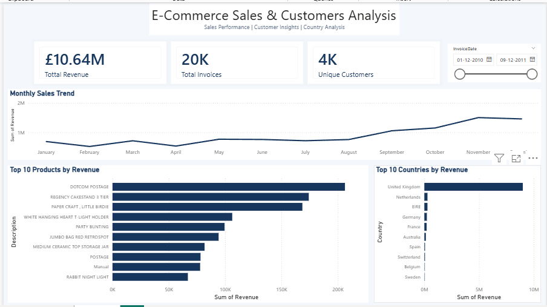

# E-Commerce Sales & Customer Analysis

A beginner-friendly Data Analyst portfolio project using Python, MySQL, and Power BI to analyse online retail sales data and identify business insights.

## Project Overview

This project analyses online retail transactions to understand sales performance across time, countries, and products.

The project workflow includes data exploration, data cleaning, data validation, SQL-based analysis, and an interactive Power BI dashboard.

## Tools & Technologies

- **Python** — Data cleaning and validation
- **Pandas** — Data manipulation
- **MySQL** — SQL queries and sales analysis
- **Power BI** — Interactive dashboard and visualisation
- **Excel** — Source dataset
- **Visual Studio Code** — Development environment

## Project Objectives

- Clean and validate retail transaction data.
- Analyse total revenue and invoice activity.
- Identify countries contributing the most revenue.
- Compare product-level sales performance.
- Explore monthly sales trends.
- Present findings through an interactive dashboard.

## Dataset

The project uses the Online Retail dataset containing transaction details such as invoice number, product code, product description, quantity, invoice date, unit price, customer ID, and country.

## Project Structure

```text
Data Analyst Project/
├── data/
├── powerbi/
├── python/
├── reports/
├── sql/
├── .gitignore
└── README.md
```

## Current Analysis Highlights

- **Total Revenue:** £10,642,110.80
- **Top Revenue Country:** United Kingdom
- **Analysis Tools:** Python, MySQL, and Power BI
- 
## SQL Analysis Findings

- **Total Revenue:** £10,642,110.80 across the cleaned transactions.
- **Top Revenue Country:** United Kingdom, contributing approximately 84.59% of total revenue.
- **Country Analysis:** The Netherlands and EIRE were the next largest contributors by revenue.
- **Product Analysis:** Identified top revenue-generating product codes and descriptions.
- **Monthly Sales Trend:** Analysed revenue patterns over time using invoice dates.

## Business Insights

- The United Kingdom is the primary revenue contributor in this dataset.
- Revenue is concentrated in a small number of leading countries.
- Product-level analysis helps identify high-revenue items for further investigation.

*Note: Revenue represents sales value, not profit. Findings are based on the cleaned dataset and its filtering rules.*
Revenue represents the sum of transaction sales values after the project's cleaning steps; it is not profit.

## Dashboard


The Power BI dashboard includes KPI cards for total revenue, total invoices, and unique customers, along with monthly sales trends, country-wise revenue, product revenue, and a date slicer.

## Data Cleaning

The cleaning workflow removes duplicate records, rows with missing product descriptions, cancelled invoices, and records with non-positive quantities or unit prices. A revenue column is calculated using quantity multiplied by unit price.

## Future Improvements

- Add dashboard screenshots.
- Document key SQL queries and findings.
- Add instructions for reproducing the analysis.
- Publish the completed project files on GitHub.
